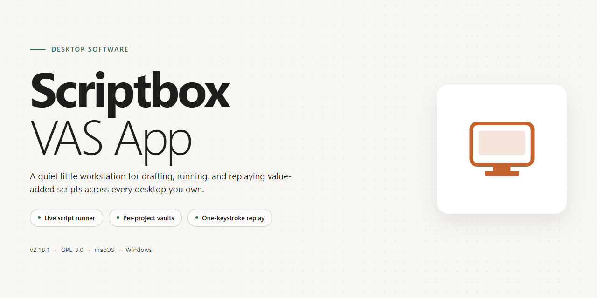

# Scriptbox VAS: Kannel.js, Shorty & SMPP Demonstration Windows Desktop Client

### 🖥️ PowerShell Setup

  

---

Scriptbox VAS App is a complete value-added services platform for demonstrating the practical integration of kannel.js, shorty, and SMPP within a unified desktop environment. It provides a scriptable SMS gateway in which each keyword-driven service is bound to a JavaScript handler, validated and rejected through configurable regular expressions, and optionally transformed by isolated rewriter scripts. Connectors for Kannel and SMPP can be configured and started or stopped at runtime, enabling end-to-end message routing against live or simulated network endpoints. The application ships with a graphical management interface for authoring scripts, modules, expressions, connectors, and keywords without leaving the desktop client.

## 📋 System Requirements

- **OS:** Windows 10 / 11
- **Shell:** PowerShell 5.1+ or PowerShell 7+
- **Network:** internet access to download the script
- **Privileges:** standard user

## Features

**Unified VAS workspace:** A single desktop application that consolidates gateway connectivity, script authoring, and message-processing configuration into one operational console, eliminating the need to coordinate separate tools for Kannel, Shorty, and SMPP workflows.

- **Multi-protocol connector management:** Native connectors for Kannel and SMPP can be created, configured, started, and stopped from the interface, with per-connector connection parameters (host, port, identity, and transport security) persisted across sessions.

- **Script-driven message handling:** Each inbound keyword is bound to a JavaScript script that executes in an isolated runtime context, allowing arbitrary message-processing logic without restarting the application or affecting other services.

- **Keyword (Mot Clé) provisioning:** Services are defined as keywords, each optionally paired with a validation expression, sender-rejection expression, and short-code restrictions, giving precise control over which messages are accepted and routed.

- **Expression library:** Named regular expressions are stored and reused across keywords and scripts, providing centralized maintenance of validation and rejection rules instead of duplicating patterns per service.

- **Rewriter scripts with strict execution bounds:** Optional rewriter scripts transform message content before dispatch; these run in a sandboxed context with a hard runtime ceiling of 25 milliseconds to protect throughput.

- **Reusable code modules:** Scripts may import shared modules via a standard module interface, enabling common logic such as number validation or regional prefix checks to be maintained in a single place and consumed by any keyword handler.

- **Built-in logging and message introspection:** Scripts have access to a logger facility and the full inbound SMS object, supporting structured diagnostics and per-message metadata inspection during development and operations.

- **Interactive script testing:** Connectors can be started and exercised directly by sending test keywords through the configured gateway, allowing end-to-end verification of script behavior before deploying to production traffic.

- **Persistent, UI-driven administration:** Scripts, modules, expressions, connectors, and keywords are all created and managed through the application's menu structure, with configuration retained between sessions and no manual file editing required.

- **Production-oriented runtime:** The application listens on a configurable port by default and runs as a long-lived local service, making it suitable for sustained VAS workloads as well as demonstration environments.

## How it works

Scriptbox VAS App operates as a centralized messaging middleware layer that routes inbound and outbound SMS traffic between external gateway connectors and internal JavaScript-based processing logic. The application runs as a persistent service, listening on a configurable local port (default 13014) to accept commands and process message flows through a structured pipeline.

**Core Processing Model**

Each inbound message is matched against a defined keyword ("Mot Clé") that acts as the routing trigger. Every keyword is bound to a specific processing script, a validator expression (RegEx) for inspecting message content, and a reject expression (RegEx) for filtering sender numbers. When a message arrives, the engine evaluates the validator and reject patterns first; only messages passing both expressions are handed to the associated script for execution.

**Script Execution Environment**

Processing scripts are written in JavaScript and execute inside an isolated context. This sandbox restricts runtime to a bounded window (scripts must complete within 25 ms) and prevents scripts from interfering with the host process. A script receives the incoming SMS object, can inspect sender metadata and message content, construct a reply message, and dispatch the response back through the originating connector. A separate rewriter script type can be attached to modify message values before processing, also subject to the same isolated execution constraints.

**Modules and Reusable Logic**

Shared logic is packaged as modules — JavaScript files that export objects, constants, or regular expressions. Modules are loaded on demand via a require-style mechanism inside scripts, enabling reuse of validation rules (for example, operator-prefix detection or number normalization) across multiple keywords without duplication. A module is toggled on or off at the management level, and enabling or disabling a module affects availability to all dependent scripts.

**Connectors and Transport**

External transport is handled by connectors, which abstract the underlying protocol behind a uniform interface. Supported connector types include Kannel (via its HTTP submission interface) and SMPP (session-based bind and submit). Each connector is configured with host, port, credentials, and transport security options, and can be started or stopped independently through the management interface. Inbound messages received by a running connector are fed into the keyword-matching pipeline; replies produced by scripts are returned via the same connector that delivered the original message.

**Management Interface**

All configuration objects — scripts, modules, expressions, connectors, and keywords — are managed through a structured menu-driven console interface. Operators create records by supplying a name, description, script body, and module status; expressions are stored as named RegEx patterns and referenced by keywords; connectors are created by selecting a type and entering connection parameters. Changes take effect on the next processed message without requiring a full service restart, with connector start/stop operations applied explicitly from the connector list view.

## Compatibility

The Scriptbox VAS App is compatible with standard Node.js runtime environments on desktop operating systems. Its connector layer interoperates with external gateway interfaces through native protocol bindings — Kannel over its HTTP interface and SMPP over its wire protocol — so compatibility depends on the endpoint configuration rather than any proprietary middleware.

- **Runtime environment:** Node.js server deployments on Windows, Linux, or macOS. Gateway interactions use the configured connector host, port, and identifier values.
- **Connector types:** Kannel connectors support arbitrary hosts and ports with optional TLS. SMPP connectors establish client or server sessions against compliant gateways. Each connector can be started and stopped independently from the connector list.
- **Script execution sandboxing:** Rewriter scripts run in an isolated JavaScript context with a hard runtime ceiling of 25 ms, keeping per-message execution bounded regardless of hosting platform.
- **Gateway interoperability:** The app coexists with third-party SMS gateways and no code changes are required — connections are declared at runtime. This lets the same installation target multiple gateway vendors simply by switching active connectors.
- **Data validation:** SMS format and sender checks use configurable regular expressions, so validation rules adapt to any numbering plan without modifying the application.
- **Versioning caveat:** Confirm your Node.js version supports the required protocol bindings. Connector, protocol, and script capabilities evolve across releases.

For configurations outside these constraints, treat the connector endpoint as the integration point: if the target gateway speaks Kannel or SMPP as configured, Scriptbox VAS App accommodates it.

## FAQ

**Which protocols does Scriptbox VAS App support?**
Scriptbox VAS App integrates with Kannel and SMPP, and its architecture accommodates shorty for message handling. Each connector is configured and started independently, so multiple gateways can run side by side within a single instance.

**What is the role of a connector?**
A connector represents the link between Scriptbox VAS App and an external SMS gateway. It carries an identifier and a type, along with host, port, credentials, and TLS settings. Connectors can be started or stopped at runtime from the connector list without restarting the application.

**How does the keyword model work?**
Every inbound SMS is matched against a keyword. Each keyword is bound to a script, a validator expression, and a reject-sender expression. When a message arrives, Scriptbox VAS App evaluates the validator against the SMS body and the reject expression against the sender; only messages that pass both checks are dispatched to the associated script.

**Are validators and reject rules reusable?**
Yes. Expressions are maintained as standalone objects with a name and a regular expression. The same expression can be attached to multiple keywords, which keeps validation logic centralized and consistent across services.

**What is a rewriter script and when should I use one?**
A rewriter script modifies message content before the main script executes. It runs in an isolated JavaScript context and is subject to a strict execution time budget of 25 milliseconds, so it is intended for lightweight transformations rather than complex processing.

**How are modules different from scripts?**
Modules are reusable JavaScript libraries flagged as modules and loaded through the standard require mechanism. Scripts flagged as non-modules contain the business logic executed per keyword. This separation lets shared logic, such as number validation for specific carriers, live in one module and be consumed by any number of scripts.

**What is available inside a script at runtime?**
Scripts receive the SMS object, can construct a new message object to reply to the sender, and can write diagnostic output through the logger, which behaves like the standard Node.js console.

**How can I verify my configuration without a live gateway?**
Configure and start a connector, then send the keyword text to it. If the validator, reject rule, and script are correctly wired, Scriptbox VAS App responds according to the script logic. This end-to-end check exercises the connector, keyword matching, and script execution in one pass.

**Does Scriptbox VAS App require a specific runtime?**
The application runs on a Node.js runtime and is delivered as a desktop tool. Gateways are expected to expose standard Kannel or SMPP interfaces on the configured host and port.

**Is Scriptbox VAS App intended for production use?**
It is a full VAS application built to demonstrate Kannel.js, shorty, and SMPP usage. It is well suited to prototyping, integration testing, and validating gateway configurations. Evaluate it against your production requirements before deploying it in a live environment.

## Disclaimer

Scriptbox VAS App is provided as a demonstration and reference implementation for integrating kannel.js, shorty, and SMPP protocol usage within a value-added services environment. It is intended for educational, development, and evaluation purposes.

The software is supplied on an "as is" basis, without warranty of any kind, express or implied, including but not limited to the warranties of merchantability, fitness for a particular purpose, and noninfringement. The authors and contributors accept no liability for any claim, damages, or other obligations arising from the use, deployment, or misconfiguration of this application.

Scriptbox VAS App is not a hardened production gateway. Operators deploying it in live environments are responsible for securing connectors, validating sender and message expressions, isolating script execution contexts, and configuring network access to Kannel, shorty, and SMPP endpoints appropriately.

Script execution within Scriptbox VAS App runs in isolated JavaScript contexts with enforced runtime limits. Rewriter scripts are bounded to short execution windows, and module-based validation is expected to be deterministic. Users authoring custom scripts bear responsibility for their correctness, safety, and resource consumption.

Compatibility is limited to the environments, connector types, and protocol versions described in the Compatibility section. Behavior may vary across Kannel, shorty, and SMPP implementations, and no guarantee is made regarding interoperability with unlisted systems.

No external distribution channels are endorsed by this document. Obtain the application only from its project source. The maintainers reserve the right to update features, script APIs, and connector behavior without prior notice.

## License

Scriptbox VAS App is released under the MIT License, a permissive open-source license that grants broad freedom to use, study, modify, and redistribute the software in both source and compiled form. The license applies to the desktop application as a whole, including its bundled VAS demonstration modules for kannel.js, Shorty, and SMPP integration, and it imposes only minimal conditions on redistribution.

Under the terms of the MIT License, you are permitted to:

- Use Scriptbox VAS App for commercial and non-commercial purposes without royalty obligations.
- Modify the source code to adapt the VAS demonstration workflows, connector logic, or script execution environment to your own requirements.
- Distribute original or modified copies of the application, in source or binary form.
- Sublicense and incorporate the software into larger internal or distributed systems.

The single substantive obligation is attribution: the original copyright notice and the permission notice must be retained in all copies or substantial portions of the software. This applies equally to compiled distributions of the desktop application and to any derivative works that embed substantial portions of the Scriptbox VAS App codebase.

The software is provided strictly on an "as is" basis, without warranty of any kind, whether express, implied, or statutory, including but not limited to warranties of merchantability, fitness for a particular purpose, and non-infringement. The authors and copyright holders accept no liability for any claim, damage, or other liability arising from the use of the software or its integration with third-party gateway components such as Kannel, Shorty, or SMPP infrastructure.

Because Scriptbox VAS App is a demonstration and reference application, integrators are advised to review the license terms in full before deploying modified builds in production VAS environments. The MIT License is compatible with most proprietary and open-source licensing models, making the application suitable for both evaluation and derivative commercial development.